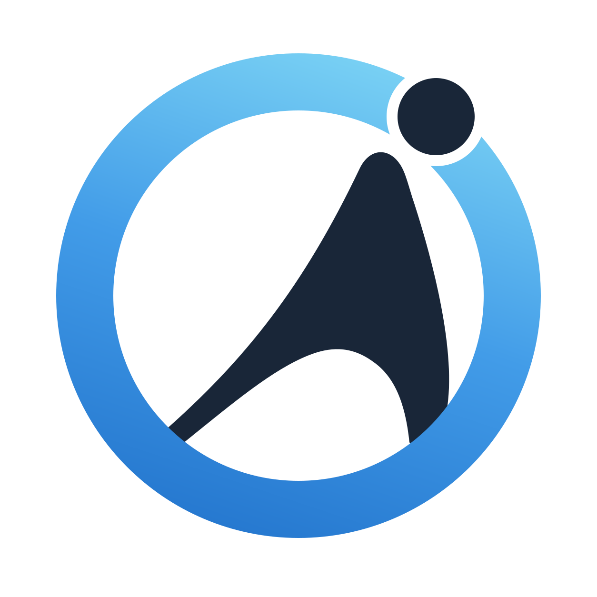
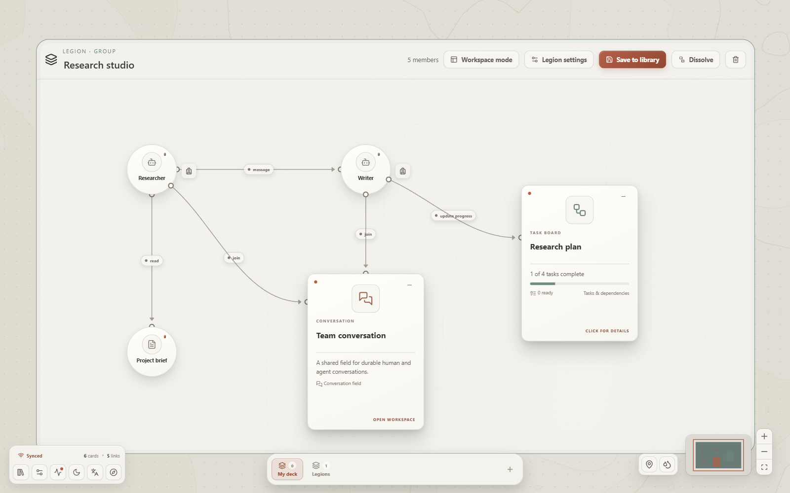
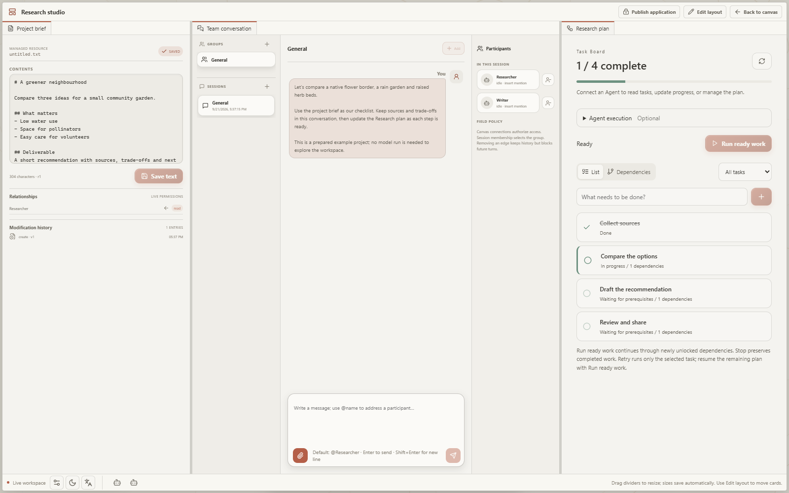

<picture>
  <source media="(prefers-color-scheme: dark)" srcset="docs/assets/logo-dark.svg" />
  
</picture>

# Open Agent World

[English](README.md) | **简体中文**

**把 AI 团队放到一张画布上。**

连接智能体、文件和工具，让每个智能体各司其职，在同一个工作空间里协作。

[下载](https://github.com/theAfish/open-agent-world/releases) · [使用指南](docs/user-guide/index.zh-CN.md) · [开发卡片与卡包](docs/developers/index.zh-CN.md) · [在线文档](https://theafish.github.io/open-agent-world/zh-CN/)

<picture>
  <source media="(prefers-color-scheme: dark)" srcset="docs/assets/demos/world-overview-dark.png" />
  
</picture>

## 看看它能做什么

### 连起你的 AI 团队

给智能体共享资料，也给它们协作的方式。拖出一条连线，选择允许它做什么：读取文档、使用工具，或与另一个智能体交流。

### 给团队一个 Legion 工作区

把相连的卡片组成 **Legion**，再进入**工作区模式**，并排使用对话、笔记和工具。分屏、叠放标签页，保存属于这个 Legion 的布局；需要共享指令和状态时，还可以开启团队模式。

<picture>
  <source media="(prefers-color-scheme: dark)" srcset="docs/assets/demos/legion-canvas-dark.png" />
  
</picture>

<picture>
  <source media="(prefers-color-scheme: dark)" srcset="docs/assets/demos/legion-workspace-dark.png" />
  
</picture>

### 把计划变成看得见的进展

任务、依赖和进度放在一起。完成前置任务，下一步就会变为可开始；连接的智能体也可以更新任务板。

### 把需要的工具带进工作区

通过插件加入技能工具箱、隔离沙箱和专业查看器。例如，在对话中打开结构文件，旁边的三维查看器就会跟着切换。

*以上为 OAW 实际运行界面，使用示例数据。[静态截图与录制说明](docs/assets/demos/README.md)。*

## 开始使用

1. [下载桌面应用](https://github.com/theAfish/open-agent-world/releases)，按[安装指南](docs/install.zh-CN.md)完成安装。
2. 在 **设置 → 模型** 中添加你的模型连接。
3. 跟随画布教程连接第一组卡片、组建 Legion，并布置它的工作区，也可以按[第一个团队任务](docs/user-guide/first-team.zh-CN.md)上手。

Linux 用户可在源码目录运行 `bash scripts/setup.sh` 安装，再用 `bash scripts/start.sh` 启动。前置依赖和各平台的源码运行方式见[源码指南](docs/getting-started.zh-CN.md)。

## 文档

| 目标 | 入口 |
| --- | --- |
| 安装并完成第一个任务 | [用户指南](docs/user-guide/index.zh-CN.md) |
| 开发 Python/React 卡片并打包 | [Card / Pack 开发指南](docs/developers/index.zh-CN.md) |
| 查询 API、格式与安全边界 | [技术参考](docs/reference/index.md) |
| 开发、测试、发布或部署宿主 | [贡献者与维护者](docs/contributing/index.zh-CN.md) |

[第一个团队任务](docs/user-guide/first-team.zh-CN.md) · [卡包与卡牌](docs/user-guide/plugins.zh-CN.md) · [Card / Pack 开发](docs/developers/index.zh-CN.md) · [参与贡献](docs/contributing/index.zh-CN.md)

这里的文档跟随 **dev**。已安装版本的 **帮助 → 文档** 随版本打包；dev 功能可能尚未发布。

OAW 是实验性项目。仓库目前未包含许可证文件。
